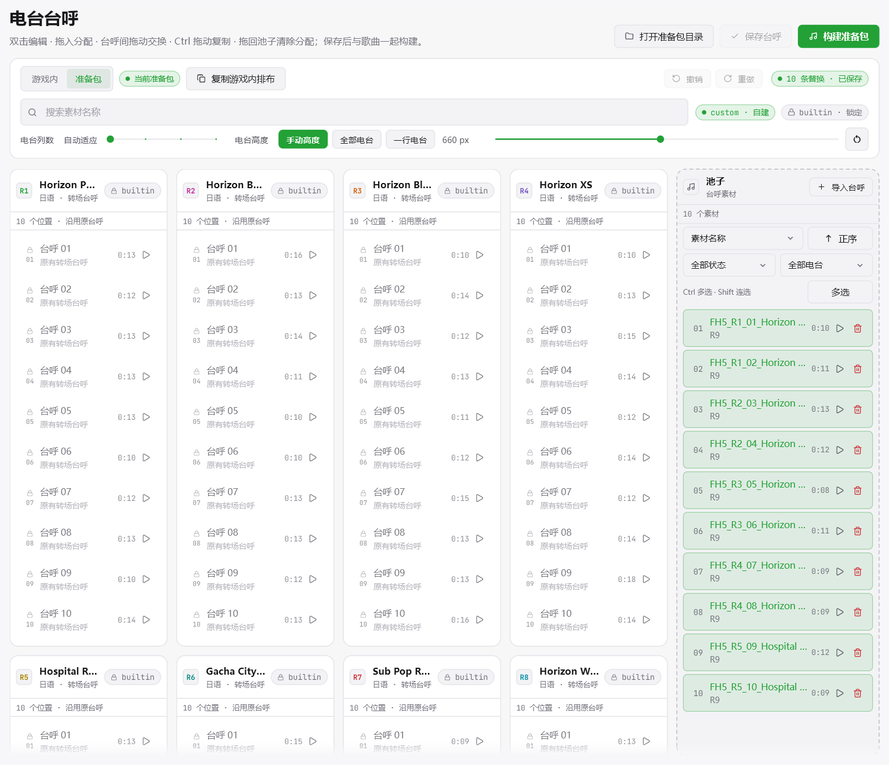
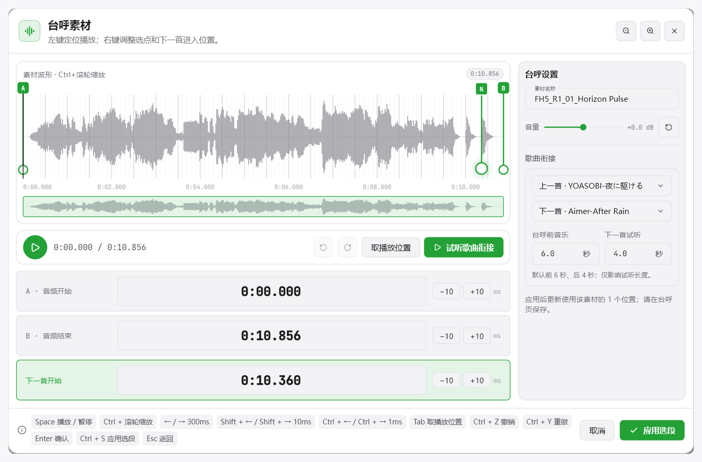
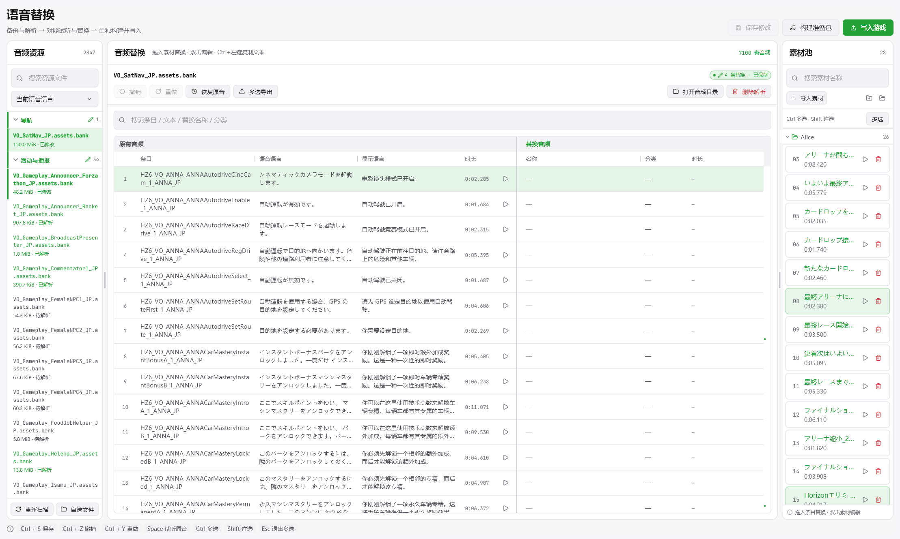
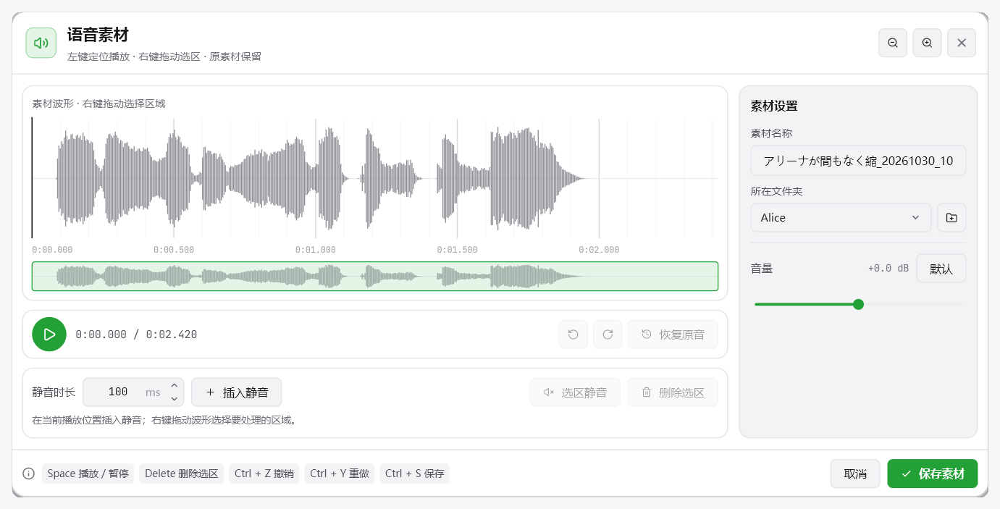

# FH Audio Studio

**1.0 Preview** · 面向 **Forza Horizon 6 PC 版**的音乐与音频替换工作台。导入歌曲、调整播放与循环时间、编排电台，也能替换转场台呼及其他语音，试听确认后构建准备包并写入游戏。

基于 [FH Radio Studio](https://github.com/Pzzzzz5142/FH-Radio-Studio) 持续改进，集成 [SeamlessLoopMusic](https://github.com/CPUrising/seamless-loop-music) 循环建议。当前主版本已整合歌曲、电台台呼和语音替换工作流。

**[下载与版本说明](https://github.com/buuuuuuuuuug/FH-Radio-Studio-Improve/releases) · [详细功能说明](docs/改动说明-详细版.md) · [本次更新](docs/releases/v1.0.0-preview.1.md)**

## 核心功能

| 功能 | 简介 |
| --- | --- |
| 电台与歌单 | 导入歌曲、编辑曲名与歌手、拖动编排歌单，支持电台扩容及漫游／比赛分场景编排。 |
| 循环分析与人工精修 | 提供 SeamlessLoopMusic 循环建议和可选 AI 分析，支持波形编辑、节拍磁吸、毫秒微调及切入／循环试听。 |
| 台呼与歌曲转场 | 替换原有台呼，裁剪音频、调整音量与下一首进入位置，试听前后歌曲衔接，与歌曲一起构建。 |
| 游戏语音替换 | 按类别和语言浏览资源，也可自选文件；备份解析后逐条替换，对照原音、替换音频与对应文本。 |
| 素材管理与音频编辑 | 按文件夹管理素材，支持台呼裁剪、插入静音、选区静音／删除、音量调整和撤销重做，保留原素材。 |
| 批量操作与导入导出 | 搜索筛选、多选分配、批量分析、时间点导入导出，以及语音文本 TXT／CSV／XLSX 导出与实时预览。 |

电台扩容和分场景编排为实验功能，分场景编排需要先开启扩容。

## 工具特色

- **构建与写入**：编辑、试听、构建和写入在工具内完成；支持音量预览、写入清单、按文件选择及原文件备份与恢复。
- **便携运行**：Windows 包附带基础 Python 环境和核心音频工具；无 AI 模式也可使用 SeamlessLoopMusic 循环建议，AI 依赖按需准备。
- **操作与引导**：统一波形和播放操作，支持拖放、多选及快捷键；首次进入提供功能介绍，右上角问号可随时重看。

## 界面与功能

### 基础设置

选择游戏目录、显示语言和语音语言，按需使用手动或 AI 分析。**推荐启用 SeamlessLoopMusic**：更关注循环前后的音高与响度衔接，无 AI 模式也能使用，无需加载重型模型。循环同步、扩容和分场景编辑可分别配置。

### 自建歌曲

集中查看歌曲、配置进度与电台归属，支持搜索、排序、筛选、快速试听和批量分配。可从文件选择器或拖放导入音频，也可使用塞壬唱片入口。

### 歌曲编辑

修改歌曲名、歌手和 BPM，在波形上查看 TD／TL／PD／PL 配置与分析信息。双击时间组进入人工精修，试听后保存；仅用于漫游的歌曲无需确认比赛点位。

### 人工精修

左键定位播放，右键调整时间点；支持缩放、磁吸到拍、直接输入和按拍／毫秒微调。右侧循环建议可套用比较，配合拼接试听、撤销和重做确定衔接。

### 播放列表

在“准备包”编排、在“游戏内”核对，支持拖动排序、跨电台移动、多选和撤销重做。分场景编辑可独立安排漫游／比赛，并保留切换前的两套排布；此功能需要开启电台扩容。

### 电台台呼

像编排歌单一样拖入和分配台呼素材，支持原有台呼试听、素材管理及保存草稿。台呼与歌曲一起构建，使用同一份 RadioInfo 配置；按电台现有台呼位置替换。

### 台呼素材与衔接试听

裁剪音频、调整音量和“下一首开始”位置，选择前后歌曲试听转场，也可对比原有台呼。衔接试听默认保留台呼前 6 秒音乐和下一首 4 秒，不改变台呼自身的时间刻度。

### 语音替换

按分类与语言查找游戏音频，也可自选文件；备份解析后，对照原音、文本和替换素材逐条操作。文本列跟随显示／语音语言，支持搜索、复制及 TXT、CSV、XLSX 导出。语音准备包单独构建、单独写入。

### 语音素材编辑

双击素材进入波形编辑，左键定位播放、右键拖出选区；可插入静音、静音或删除选区，调整音量并撤销重做。保留原始素材，支持文件夹管理、多选、拖入导入和已使用状态提示。

### 时间点导入导出

通过表格文本或文件批量交换时间点，先预览匹配与错误再应用；导入前自动备份。具体格式和匹配规则见[详细说明](docs/改动说明-详细版.md#时间点导入导出)。

## 开始使用

1. 完整解压 Windows 便携包，运行 `fh-radio-studio.exe`；新工程路径使用英文、数字或常用英文符号。
2. 在概览选择游戏与语言，检查环境并建立原始备份。
3. 导入、编辑和分配音频，保存后构建准备包，核对写入清单再写入游戏。

歌曲与台呼共用准备包，语音替换使用独立准备包。**构建本身不会写入游戏。** 写入前退出游戏；游戏更新后重新检查兼容性。升级建议先解压到新目录，再打开已有工程。

主要使用和验证平台为 **Windows x64**。AI 依赖可按需准备；可先使用“无 AI＋SeamlessLoopMusic”。扩容和分场景编辑仍是实验功能，语音实际播放长度与触发效果也受游戏事件控制。

## 项目说明与反馈

这是我的第一次尝试。本 Fork 的改进代码由 **ChatGPT 辅助生成并持续调整，全程 Vibe Coding**。已进行自动化测试和本地运行验证，仍可能存在未发现的问题；具体版本的验证范围以 Release 说明为准。

欢迎在 [Issues](https://github.com/buuuuuuuuuug/FH-Radio-Studio-Improve/issues) 提交问题和建议，并附上复现步骤、报错及截图。分享日志前请隐去个人信息。

原项目与第三方组件的贡献归各自作者所有，本 Fork 的开发说明不代表原作者。项目与游戏官方无隶属关系，音频、工具和模型遵循各自适用的授权。

[来源与分发说明](docs/third-party-notices.md) · [开发说明](docs/development.md) · [详细功能说明](docs/改动说明-详细版.md)
