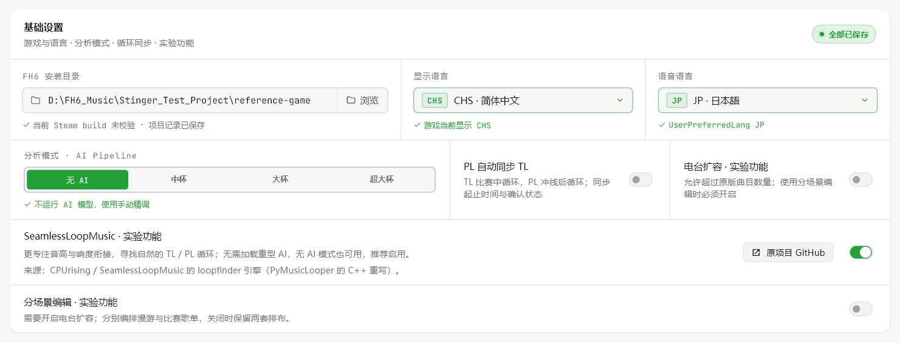
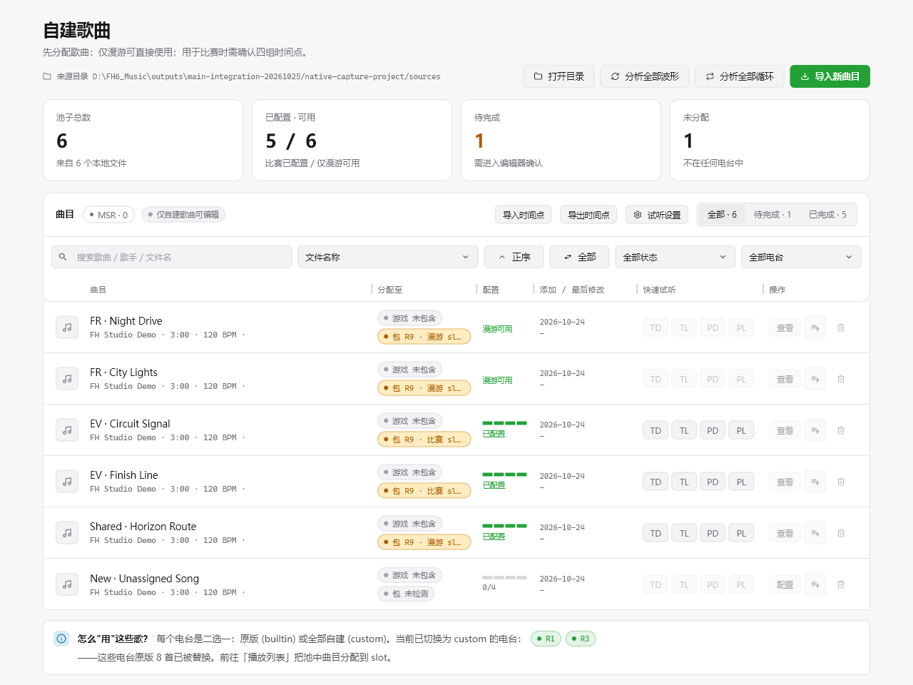
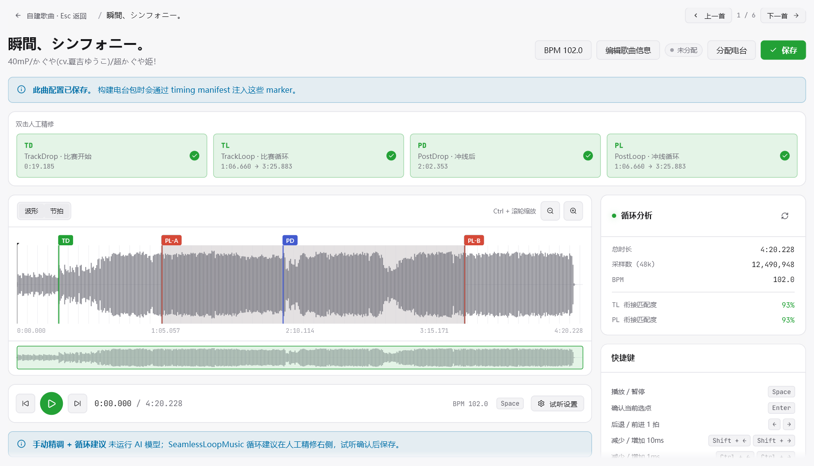
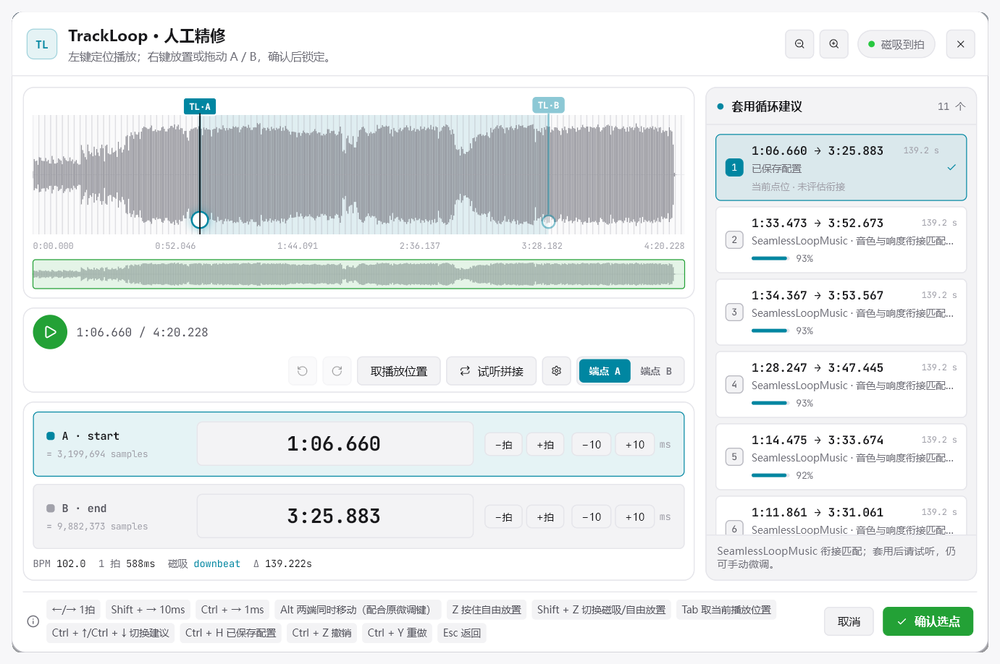
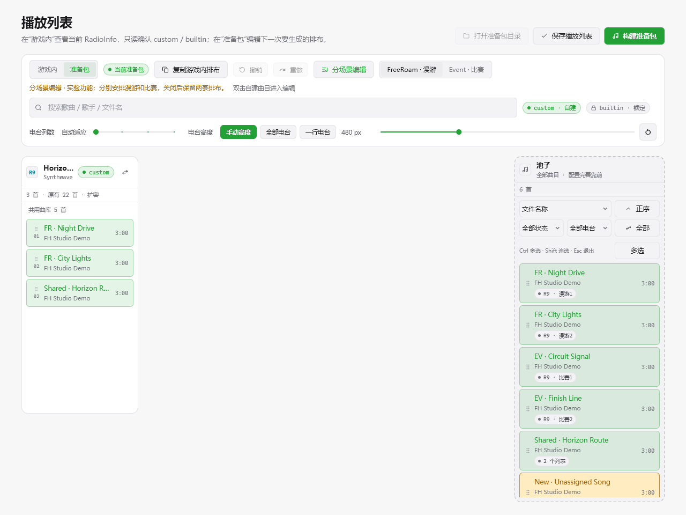

# FH-Radio-Studio-Improve

面向 **Forza Horizon 6 PC 版**的自定义电台工具，以 **LoopLab** 为主要版本。导入喜欢的音乐，设置歌曲切入点和循环段，编排电台播放列表，再构建准备包并写入游戏。

本项目基于 [Pzzzzz5142/FH-Radio-Studio](https://github.com/Pzzzzz5142/FH-Radio-Studio) 持续改进，集成 [SeamlessLoopMusic](https://github.com/CPUrising/seamless-loop-music) 循环建议，提供手动选点、批量时间点交换、电台编排和构建设置等功能。原项目与第三方组件的贡献归各自作者所有。

**[下载与版本说明](https://github.com/buuuuuuuuuug/FH-Radio-Studio-Improve/releases) · [详细功能说明](docs/改动说明-详细版.md) · [问题反馈](https://github.com/buuuuuuuuuug/FH-Radio-Studio-Improve/issues)**

**v0.2.1-preview.4** 将分场景测试版的更新整合到主程序：新增漫游／比赛独立编排、随时开关并保留双场景快照、跨场景歌单套用和场景筛选。使用分场景编辑必须先开启电台扩容；仅用于漫游的歌曲无需人工确认比赛时间点。基础设置的逐项功能引导、分配快捷键和歌曲池布局也已同步完善。

## 项目说明与反馈

这是我的第一次尝试。本项目的改进代码基于 **ChatGPT 生成并持续调整，全程 Vibe Coding**，目前仅进行了有限的自动化测试和实际使用测试，可能仍存在尚未发现的问题。

如果遇到任何问题，或有使用建议，欢迎随时在 [Issues](https://github.com/buuuuuuuuuug/FH-Radio-Studio-Improve/issues) 提出。请尽量附上复现步骤、错误提示和截图，分享日志时注意隐去个人信息。

这段说明仅针对本 Fork 的改进工作，不代表原作者及第三方组件的开发方式。

## 首次使用与功能介绍

首次进入基础设置、自建歌曲、歌曲编辑、人工精修、播放列表和设置时，会通过画框与简短文字介绍核心操作。点击界面右上角的问号可重新查看当前页面介绍。新建工程会添加一首原创合成演示曲，方便串联体验歌曲列表、选点与精修，介绍后可删除。概览基础设置中的游戏与语言、分析模式、PL 同步 TL、电台扩容、SeamlessLoopMusic 和分场景编辑均有独立引导，循环引擎单独说明优点与使用方法，最后介绍检查与写入；其他页面也介绍试听设置和循环建议。

## 基础设置：按自己的习惯配置

- 设置 FH6 安装目录、显示语言与语音语言，查看当前识别结果和保存状态。
- 提供 **无 AI、中杯、大杯、超大杯**分析模式。无 AI 模式可直接读取波形，手动设置并确认时间点。
- 可启用 **PL 自动同步 TL**：TL 用于比赛中循环，PL 用于冲线后循环；开启后同步两组循环的起止点与确认状态，也可以分别编辑。
- 默认启用 **SeamlessLoopMusic 循环建议**：在无 AI 模式下也能查找 TL／PL 循环候选，套用后通过试听和微调确定最终结果；已有用户的开关选择会保留。
- 提供**电台扩容**实验开关，按实际音源数量和 bank 大小检查容量。

**推荐启用 SeamlessLoopMusic。** 相比原有 AI 的循环选点，它更专注循环终点回到起点的音高特征与响度衔接，方便挑选和试听比较 TL／PL 候选。只需寻找循环时，可配合“无 AI”模式使用，无需加载重型模型；启用 AI 时，TD／PD 等分析仍然保留。建议套用后试听确认。

## 自建歌曲：集中管理音乐与配置

导入本地音频后，可在歌曲库查看曲名、歌手、时长、配置进度及电台归属。列表支持按歌曲、歌手、文件名搜索，结合配置状态、电台和排序条件筛选，列宽也可以拖动调整。

页面顶部汇总歌曲总数、已配置、待完成与未分配数量；每首歌提供 TD／TL／PD／PL 快速试听、编辑和分配入口。默认按“文件名称”排序，也可选择歌手名称、歌曲名称或修改日期，并切换正序／倒序；搜索框支持一键清空。可以批量读取波形或分析循环，查看进度并取消任务，已有缓存可复用。塞壬唱片入口支持浏览、试听和导入，其显示可在设置中控制。

## 时间点导入导出：适合批量配置与备份

- 支持粘贴表格文本，以及 TXT、CSV、TSV、JSON、XLSX 和 RadioInfo XML 文件导入。
- 按文件名、曲名或曲名与歌手组合匹配，先预览匹配结果、时间点和错误，再执行导入。
- 可选择覆盖已有时间组、将完整时间组标记为已确认，以及按电台列批量分配；导入前自动备份点位。
- 时间既可以写成秒数或 `分:秒.毫秒`，也可以使用 **48000 Hz 整数采样点**。
- 导出已保存的点位为 CSV，可选电台归属，便于备份和再次导入。

四组配置对应六个时间点：

| 配置            | 用途                     |
| --------------- | ------------------------ |
| TD · TrackDrop | 比赛开始时的歌曲切入点   |
| PD · PostDrop  | 冲线后的歌曲切入点       |
| TL · TrackLoop | 比赛循环的 A／B 两个端点 |
| PL · PostLoop  | 冲线循环的 A／B 两个端点 |

## 歌曲编辑：波形定位、试听与快速确认

在同一页面查看四组配置、波形、节拍及分析信息。通过波形定位、全曲概览和缩放观察细节，使用快速试听判断切入点和循环衔接。详细波形独立缓存，整曲和放大视图均保留细节。

歌曲信息可直接修改曲名和歌手；BPM 可手动输入、减半或加倍，拍线与按拍微调同步更新。应用后保存歌曲配置。

双击配置卡片进入人工精修，`Ctrl + 右键` 可快速确认。上方提供歌曲切换、分配电台和保存入口，支持按当前列表顺序连续编辑；离开含有未保存内容的页面时可选择保存、放弃或继续编辑。

卡片按 TD、TL、PD、PL 排列，`Ctrl + 左键` 可快速试听。统一的“试听设置”可分别调整 TD／PD 时长，以及循环衔接前后时长和音量。循环试听检查一次 B → A 衔接后自动停止，设置窗口采用紧凑分组布局。

## 人工精修：循环建议与端点微调

- 点击或拖动波形端点，也可直接输入时间，按一拍、10 ms 或 1 ms 微调；长按按钮和方向键支持连续调整。
- 磁吸到拍与自由放置可以切换，循环两端可一起平移并保持长度。
- 精修窗口独立控制播放进度，可取当前播放位置作为选点；“试听拼接”用于反复听取终点返回起点的衔接。
- 右侧集中展示循环候选，可切换、套用、继续调整，并与已保存配置比较。**每首歌最多十组候选**，不限制可保存的歌曲数量。
- 支持独立撤销与恢复已保存配置；确认选点后回到歌曲页面保存。

候选匹配百分比是算法评分，最终效果请以试听为准。SeamlessLoopMusic 与电台扩容均为实验功能。

## 播放列表：分场景编排与批量操作

分别查看“游戏内”排布和“准备包”草稿，默认使用统一排布。在概览基础设置或播放列表工具栏开启**分场景编辑**实验功能后，可分别编排 FreeRoam（漫游）与 Event（比赛）。电台卡片显示容量、共用曲库数量和歌曲顺序，右侧歌曲池支持搜索、筛选及配置进度查看。自建歌曲列表和歌曲池可按全部、漫游、比赛筛选分配的歌曲。

**使用分场景编辑必须先开启电台扩容，且使用期间不能关闭扩容。** 需要关闭扩容时，先关闭分场景编辑，再确认电台曲目数量不超过原版容量。分场景开启时，电台卡片可点击标题右侧的双向箭头图标，确认后使用另一场景的歌单，方便先统一再分别调整。同一电台不支持一边使用原版、一边使用自建歌曲。

关闭分场景编辑时，选择一套列表作为统一排布，同时冻结保留原两套列表；保存播放列表后可随工程恢复。再次开启会恢复关闭前的快照，统一编辑期间的改动不会自动并入两套列表。

支持拖动排序、跨电台移动、移回歌曲池、批量分配，以及撤销、重做和保存。多选时点击只改变选择，开始拖动后显示组合卡片；`Esc` 可退出多选。分配窗口可用鼠标明确选择场景；分场景开启后，`1–9` 对应比赛，`Ctrl + 1–9` 对应漫游，两者均支持小键盘。

**仅用于漫游的歌曲无需人工确认比赛时间点。** 构建时为缺失点位填入默认值，不修改工程中的点位与确认状态。同一音源只要用于任一电台的比赛列表，仍需完整配置并确认六个时间点。

同一首歌分配到多个电台时，会在分配窗口、播放列表和构建前提示。构建前的响度试听支持更换歌曲和调整播放位置。

界面可调整主题、强调色、导航布局、页面宽度、精修窗口宽度、电台列数与高度；常用快捷键可自定义。

## 构建准备包并写入游戏

1. **创建项目并备份**：新工程完整路径使用英文、数字或常用英文符号，选择游戏安装目录，完成原始文件备份。
2. **导入与配置**：导入歌曲；用于比赛的歌曲设置并确认六个时间点后保存，仅用于漫游的歌曲可直接安排。
3. **编排电台**：安排并保存统一列表或分场景列表，确认比赛歌曲的配置均已完成。
4. **构建准备包**：调整响度与 Vorbis 质量（1–100，默认 50），查看各电台预计大小；完成后可打开准备包目录，或前往概览页写入游戏。
5. **退出游戏后写入**：确认目标位置、待写入包及受影响文件，再执行写入。

构建过程可停止并返回。仅打开准备包目录时也支持替换；若具体文件被其他程序独占，保留已完成的新包，解除占用后可重试替换，无需重新编码。

构建支持复用未变化电台的 bank；格式转换与响度处理直接生成槽位 WAV，重复槽位优先使用硬链接，每个电台完成后释放中间文件，减少等待和临时空间占用。

**构建准备包本身不会修改游戏文件。** 写入默认使用 `mediapc` 覆盖目录，保留 `media` 原文件；也可选择直接写入 `media`。游戏更新后请重新检查文件状态与兼容性。

## 常用快捷键

| 操作                       | 默认快捷键                                                                                   |
| -------------------------- | -------------------------------------------------------------------------------------------- |
| 保存歌曲／播放列表         | `Ctrl + S`                                                                                 |
| 撤销／播放列表重做         | `Ctrl + Z`／`Ctrl + Y`                                                                   |
| 打开 TD／PD／TL／PL 精修   | `Ctrl + 1 / 2 / 3 / 4`，支持数字小键盘                                                     |
| 上一首／下一首             | `Shift + ↑ / ↓`                                                                          |
| 分配电台                   | 歌曲页 `Ctrl + D`；分配窗口按 `1–9`，分场景时为比赛，`Ctrl + 1–9` 为漫游，支持小键盘 |
| 波形缩放                   | `Ctrl + 鼠标滚轮`                                                                          |
| 精修取当前播放位置         | `Tab`                                                                                      |
| 精修临时自由放置／切换磁吸 | 按住 `Z`／`Shift + Z`                                                                    |
| 精修两端同时微调           | `Alt` 配合原微调键                                                                         |
| 退出多选／返回             | `Esc`                                                                                      |

## 使用范围与项目来源

主要使用与验证环境为 **Windows x64**，面向 FH6 PC 文件结构；不支持主机端，DJ 语音替换不在当前范围。歌曲、配置、准备包和原始备份保存在自行选择的项目目录中，用户设置保存在当前 Windows 账户下。

- **基础项目**：[FH Radio Studio](https://github.com/Pzzzzz5142/FH-Radio-Studio)。
- **循环引擎**：[CPUrising / SeamlessLoopMusic](https://github.com/CPUrising/seamless-loop-music)。
- **在线音乐入口**：[MONSTER SIREN 塞壬唱片](https://monster-siren.hypergryph.com/)，内容权利归相应权利方所有。
- [详细功能说明](docs/改动说明-详细版.md) · [第三方来源与分发说明](docs/third-party-notices.md)。

本项目为独立改进 Fork，与游戏官方无隶属关系。第三方工具、模型与音频内容遵循各自授权；公开版本的具体附件和依赖范围以对应 Release 说明为准。
